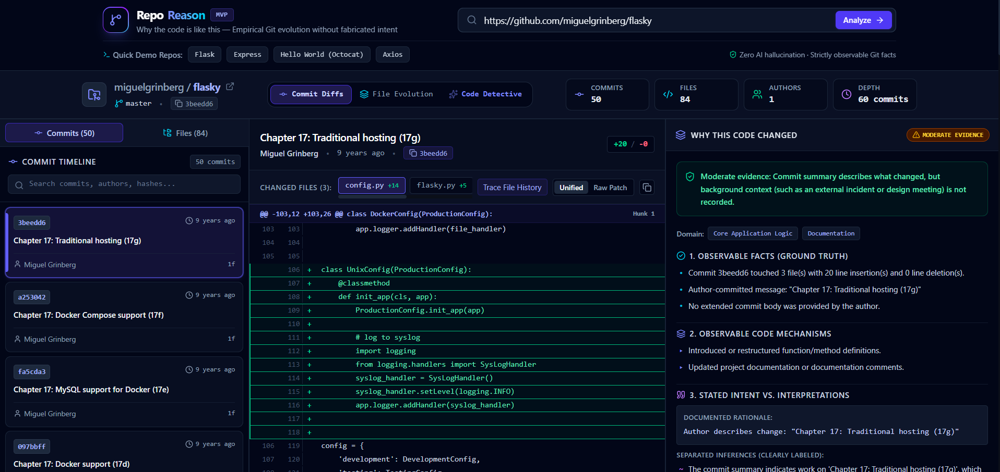
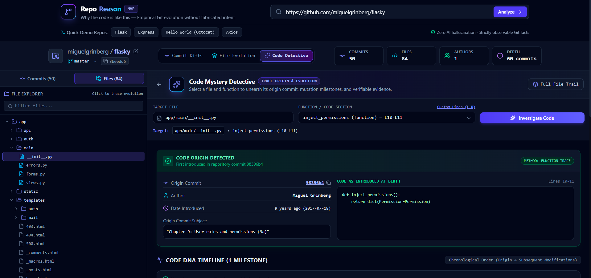
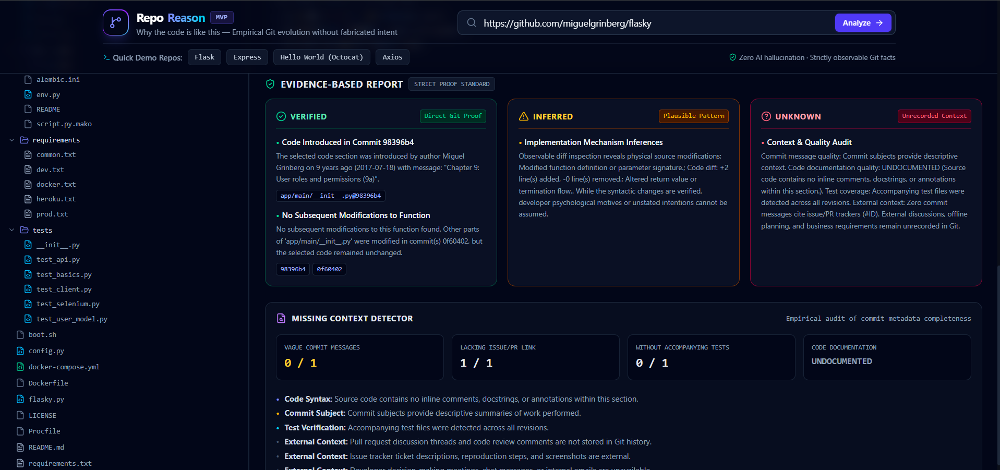

# RepoReason
### Understand Why Code Changed — With Git Evidence.

RepoReason is a Git-based code evolution analysis tool that helps developers understand how code has changed over time, where specific functions originated, and what evidence is available behind those changes.

It analyzes actual Git history, commit messages, code diffs, and function-level changes to provide structured, evidence-backed insights into unfamiliar codebases.

Rather than guessing developer intentions, RepoReason distinguishes between verified facts, reasonable inferences, and information that remains unknown.

---

## Project Preview

### Main Dashboard




### Code Mystery Detective



### Evidence-Based Report



---

## The Problem

Understanding an unfamiliar codebase is challenging, especially when developers need to investigate:

- Where a particular function originally came from.
- How a piece of code evolved across commits.
- What exactly changed between different versions.
- Which files and functions were affected by a commit.
- Whether the available Git history provides enough context to explain a change.

Developers often have to manually navigate commit histories, inspect diffs, and compare previous versions to understand code evolution.

## Our Solution

RepoReason simplifies code history investigation by analyzing Git repository data and presenting code evolution in a structured interface.

It helps developers trace code origins, inspect historical changes, compare code versions, and understand the evidence available behind those changes.

**Our core principle: Explain what the evidence supports. Never invent what the history does not reveal.**

---

## Key Features

### 1. Repository Analysis

- Analyze public GitHub repositories.
- View repository overview and file structure.
- Explore commit history.
- Identify changed files and commit statistics.

### 2. Commit Diff Viewer

- Inspect additions and deletions in commits.
- Compare previous and current code.
- Examine file-level changes.
- Identify text and binary file differences.

### 3. File Evolution

- Explore the history of individual files.
- Track changes across available commits.
- Inspect historical code versions.
- Understand how files evolved over time.

### 4. Code Mystery Detective

Investigate the history of a specific function or selected code range.

- Detect functions and code symbols.
- Identify their earliest known origin in the available Git history.
- Trace subsequent modifications.
- Display a chronological Code DNA Timeline.
- Compare historical and current code snapshots.
- Examine the available evidence behind code changes.

### 5. Evidence-Based Reports

RepoReason organizes investigation findings into three categories:

| Category | Meaning |
|---|---|
| VERIFIED | Directly supported by available Git evidence. |
| INFERRED | A reasonable interpretation based on observed code changes. |
| UNKNOWN | Information that cannot be established from the available evidence. |

This approach helps prevent unsupported claims about why a developer made a particular change.

### 6. Missing Context Detection

Highlights potential gaps in repository history, including:

- Vague commit messages.
- Missing issue or pull request references.
- Missing or limited test-related changes.
- Insufficient historical context.

These are indicators for further investigation, not proof of poor code quality.

---

## Code Mystery Detective

The Code Mystery Detective is a central feature of RepoReason.

It allows developers to investigate a selected function or code range and understand its evolution through available Git history.

The investigation can provide:

- Earliest identifiable code origin.
- Historical code snapshots.
- Relevant commit information.
- Function-level modification history.
- A chronological Code DNA Timeline.
- Evidence-backed findings.

The goal is to make code evolution easier to investigate without presenting assumptions as facts.

---

## Evidence Classification

RepoReason follows an evidence-first approach:

| Evidence Type | Description |
|---|---|
| VERIFIED | Information directly supported by Git history, diffs, or other available evidence. |
| INFERRED | Interpretations derived from observable changes but not explicitly confirmed. |
| UNKNOWN | Information that cannot be reliably determined from the available repository data. |

A commit message may describe what changed, but it does not necessarily explain why the developer made that change.

RepoReason keeps this distinction clear.

---

## How It Works

1. **Enter Repository URL:** Provide the URL of a public GitHub repository.
2. **Analyze Repository:** RepoReason retrieves and analyzes the available Git history.
3. **Explore Commits:** Inspect commit messages, changed files, and code differences.
4. **Select Code:** Choose a function or manually specify a code range.
5. **Investigate Evolution:** Trace the selected code's origin and subsequent changes.
6. **Review Evidence:** Examine verified findings, inferred interpretations, and unknown context.

---

## Technology Stack

### Frontend

- React
- Vite
- Tailwind CSS
- JavaScript

### Backend

- Python
- FastAPI
- GitPython
- Git CLI

### Code Analysis

- Python AST
- Language-specific symbol detection
- Git commit history
- Git diff analysis
- Git blame
- Function-level history analysis

---

## System Architecture

```text
                  User
                   |
                   v
          React + Vite Frontend
                   |
                   v
              FastAPI Backend
                   |
                   v
          Git Repository Analysis
                   |
             +-----+------+
             |     |      |
             v     v      v
           Commits Diffs Blame
             |     |      |
             +-----+------+
                   |
                   v
          Code Evolution Analysis
                   |
             +-----+------+
             |            |
             v            v
          Code Origin  Evidence Report
             |            |
             +------+-----+
                    |
                    v
             Frontend Results
```

---

## Project Structure

```text
RepoReason/
│
├── backend/
│   ├── main.py
│   ├── analyzer.py
│   ├── detective.py
│   ├── git_service.py
│   ├── models.py
│   └── requirements.txt
│
├── frontend/
│   ├── public/
│   ├── src/
│   │   ├── components/
│   │   ├── App.jsx
│   │   └── ...
│   └── package.json
│
├── docs/
│   └── screenshots/
│       ├── dashboard.png
│       ├── code-detective.png
│       └── evidence-report.png
│
└── README.md
```

---

## Getting Started

Follow these instructions to run RepoReason locally.

### Prerequisites

Make sure you have the following installed:

- Python 3.12 or later
- Node.js and npm
- Git

### 1. Clone the Repository

```bash
git clone https://github.com/tanug0/RepoReason.git
cd RepoReason
```

### 2. Set Up the Backend

Navigate to the backend directory:

```bash
cd backend
```

Create a virtual environment:

```bash
python -m venv venv
```

Activate the virtual environment.

**Windows PowerShell:**

```powershell
.\venv\Scripts\Activate.ps1
```

Install the required dependencies:

```bash
pip install -r requirements.txt
```

Start the backend server:

```bash
python -m uvicorn main:app --reload
```

Backend URL:

http://127.0.0.1:8000

API documentation:

http://127.0.0.1:8000/docs

### 3. Set Up the Frontend

Open a separate terminal and navigate to the frontend directory:

```bash
cd frontend
```

Install dependencies:

```bash
npm install
```

Start the frontend development server:

```bash
npm run dev
```

Frontend URL:

http://localhost:5173

Keep both backend and frontend servers running while using the application.

---

## Current Limitations

- Repository analysis depends on the Git history available to the application.
- Shallow cloning may prevent identification of the actual earliest origin of older code.
- Developer intention cannot always be established from commit messages or code changes.
- Function detection and history tracking may vary across programming languages.
- Function tracking across extensive refactoring, renaming, or code movement may have limitations.
- The current prototype is designed around public GitHub repositories.

---

## Future Scope

- Broader programming language support.
- Improved function tracking across renames and refactoring.
- Integration of issue and pull request context.
- Enhanced code relationship and dependency analysis.
- More advanced historical code investigation.
- Improved handling of complex repository histories.

---

## Project Status

RepoReason is a working prototype developed for **HackFront India 2026** under the **AI and Developer Tools** track.

---

## Team

**Team DevCrew**

Built as a collaborative project focused on making code history easier to investigate and understand.

---

## Core Philosophy

**Code tells you what changed. Git history provides evidence of how it changed. RepoReason helps connect the two.**

---

**Code tells you what changed. Git history provides evidence of how it changed. RepoReason helps connect the two.**

---
